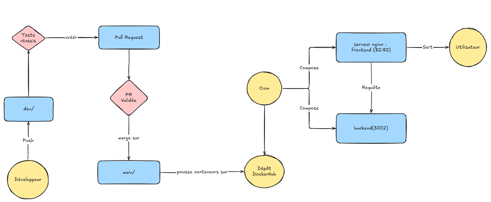

# Bouton Rouge CI/CD

Ce projet met en place une pipeline CI/CD axée sur l'analyse des vulnérabilités des dépendances. Le déploiement est continu et automatisé grâce à une tâche cron sur une VM Azure, qui héberge également un runner GitHub Actions auto-hébergé.

L'application est composée de :

- **backend** : API Express (Node.js 22), routes `/health`, `/login` et `/click`
- **frontend** : application Angular 20 servie par nginx, qui relaie les appels vers l'API

## Flux du projet



## Pipeline CI/CD (`.github/workflows/actions.yml`)

La pipeline se déclenche à chaque push sur `dev` ou `main`, ou manuellement via `workflow_dispatch`.

| Job | Rôle | Exécution |
| --- | --- | --- |
| **Détection des changements** | Liste les apps (`backend`, `frontend`) modifiées par le push | Toujours |
| **Tests unitaires** | `npm test` (Jest + Supertest) sur le backend | Si `backend/` est modifié |
| **npm audit** | Analyse des dépendances, échec à partir du niveau `high` | Toujours lancé pour les deux apps, étapes sautées si l'app n'est pas modifiée |
| **Gitleaks** | Détection de secrets dans tout l'historique Git | Toujours |
| **Build, Trivy & push** | Build des images Docker, scan Trivy (`CRITICAL`/`HIGH` corrigeables), puis push sur Docker Hub uniquement si le scan passe | Toujours lancé pour les deux apps si aucun job précédent n'a échoué, étapes sautées si l'app n'est pas modifiée |
| **Ouverture PR dev → main** | Ouvre automatiquement une PR vers `main` (une seule à la fois) | Sur `dev`, après un build réussi |
| **Déploiement (VM)** | Exécuté par le runner auto-hébergé, il met à jour la stack sur la VM | Sur `main`, après un build réussi |

### Exécution conditionnelle

Le job de détection compare le commit poussé au précédent (API GitHub `compare`) pour savoir quelles apps ont changé :

- **Aucune modification dans `backend/` ni `frontend/`** (README, `deploy/`, workflow…) : seul Gitleaks effectue un contrôle, les autres jobs sont vides ou sautés. Pas de tests, pas d'image, pas de PR, pas de déploiement.
- **Une seule app modifiée** : seuls ses contrôles et son image sont traités. Le déploiement ne recrée que le conteneur concerné.
- **Merge vers `main`** : la comparaison couvre tous les commits fusionnés, donc chaque app touchée est reconstruite.
- **Lancement manuel, nouvelle branche ou comparaison impossible** : toutes les apps sont traitées par précaution.

Les jobs `npm audit` et `Build, Trivy & push` gardent une matrice fixe (`backend`, `frontend`) : ils sont requis par la protection de `main`, ils doivent donc toujours rapporter un statut pour ne pas bloquer la PR.

Les images sont poussées dans un seul dépôt Docker Hub (`n4ssim11/bouton-rouge`) et sont différenciées par le préfixe du tag : `backend-latest`, `frontend-sha-xxxxxxx`, etc.

## Déploiement sur la VM

La stack de production (`deploy/compose.yaml`) est installée sur une VM azure, elle utilise uniquement les images Docker Hub.

Le script `deploy/deploy.sh` est appelé à la fois par le job de déploiement et par le cron de la VM :

1. Un verrou (`flock`) empêche deux déploiements simultanés.
2. `docker compose pull` récupère les dernières images.
3. `docker compose up -d --wait` recrée uniquement les conteneurs modifiés et attend que les healthchecks soient au vert.
4. Les images obsolètes sont supprimées.

Le backend n'expose aucun port sur la VM : nginx le joint par le réseau Docker (`backend:3002`). Seul le frontend est publié, sur le port `FRONT_PORT` (82 par défaut).

Exemple de cron (toutes les 5 minutes) :

```cron
*/5 * * * * /***/***/deploy.sh >> /***/***/deploy.log 2>&1
```
